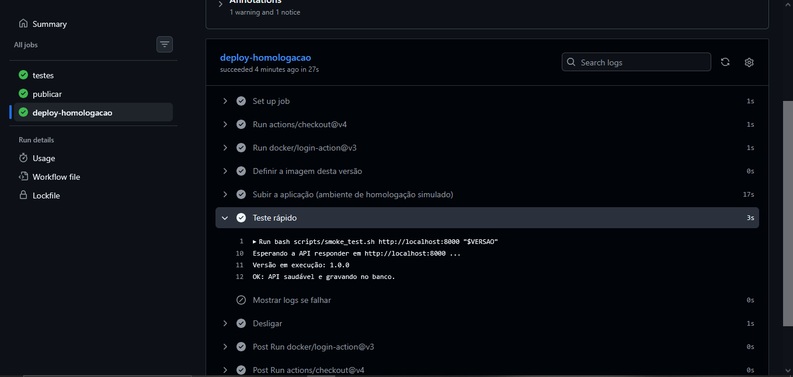
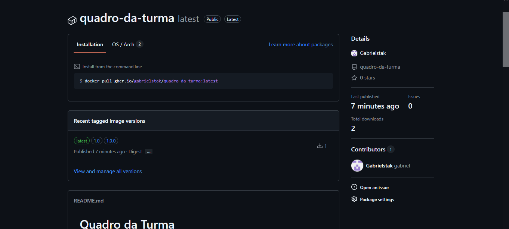
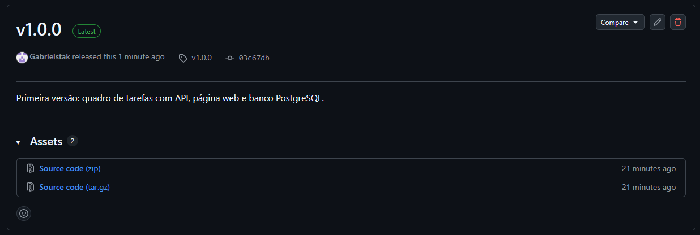
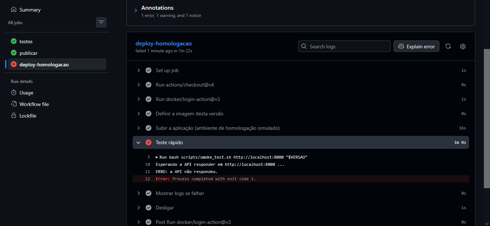
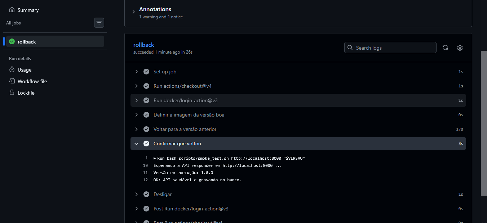
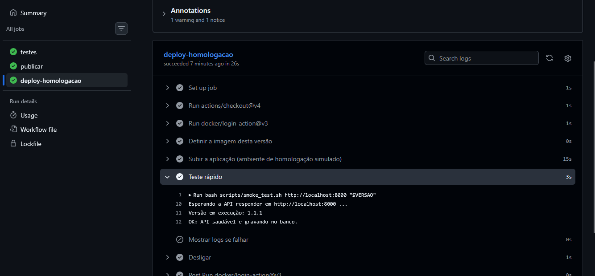
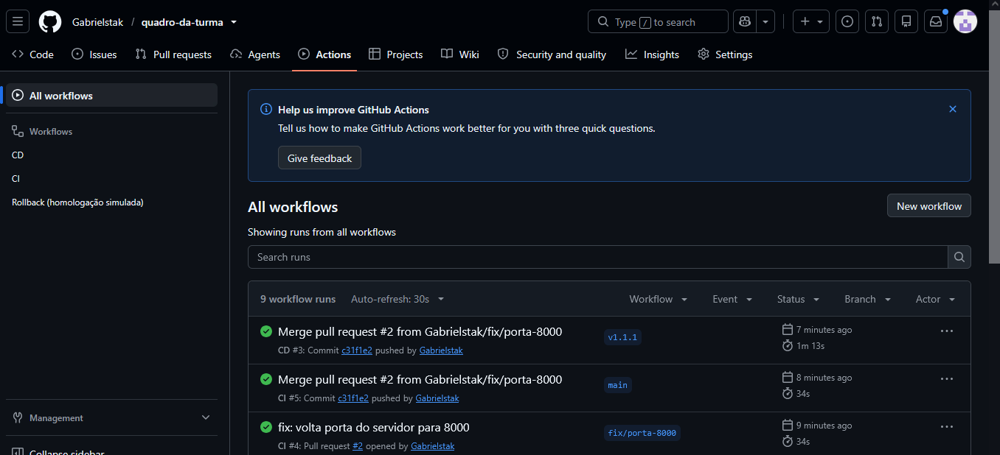

# Evidência de versionamento e rollback

Aplicação: Quadro da Turma. As imagens são publicadas no GitHub Container Registry (GHCR) e o versionamento segue o padrão semântico (`vMAIOR.MENOR.CORREÇÃO`).

## 1. Versão boa publicada (v1.0.0)

- Tag criada: `v1.0.0`
- Imagem publicada: `ghcr.io/gabrielstak/quadro-da-turma:1.0.0`
- O deploy simulado em homologação passou e o teste rápido confirmou a versão 1.0.0.

## 2. Versão com falha (v1.1.0)

- Mudança feita de propósito: no `Dockerfile`, a porta do servidor foi trocada de `8000` para `9000` (Pull Request #1).
- O CI passou, porque os testes não verificam a porta do servidor.
- O deploy em homologação falhou: o teste rápido não conseguiu falar com a API.

## 3. Rollback

- Workflow executado manualmente: **Rollback (homologação simulada)**, com a versão `1.0.0`.
- O ambiente voltou a responder e o teste rápido confirmou a versão 1.0.0 em cerca de 30 segundos.

## 4. Correção definitiva (v1.1.1)

- Pull Request #2 devolveu a porta para `8000`.
- Tag criada: `v1.1.1`. O CD ficou verde e o teste rápido confirmou a versão 1.1.1.

## Linha do tempo

## O que aprendemos

- Testes automatizados não pegam todo tipo de erro: o defeito de porta só apareceu no teste rápido depois do deploy.
- Como cada versão fica guardada no registry com uma tag, voltar para uma versão boa leva segundos.
- O versionamento semântico deixa claro o que é a versão com defeito (1.1.0) e o que é a correção (1.1.1).